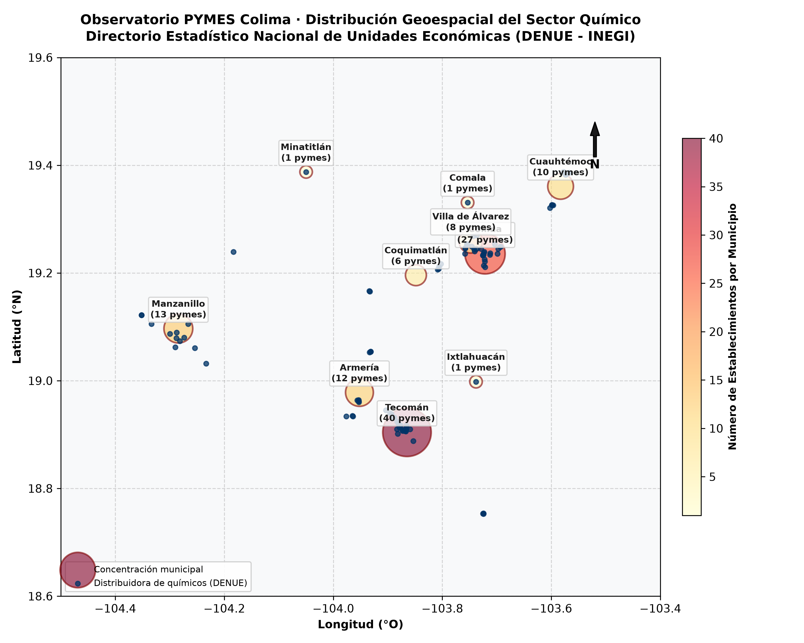

# Ficha Técnica de Entrega E2 · Fuente Especializada, Linaje Completo y Ética de Datos

**Proyecto:** Observatorio de exposición digital de pymes de distribución (Colima)  
**Equipo:** Diego Vargas  
**Fecha:** 2026-11-22  
**Etiqueta objetivo:** `e2`  

---

## 1. Inventario de Entregables

| Requisito E2 | Implementación en el repositorio | Descripción |
|---|---|---|
| **1. Fuente Especializada Integrada (Geoespacial)** | [src/bronze/denue.py](../../src/bronze/denue.py), [src/silver/geo.py](../../src/silver/geo.py), [src/gold/geo.py](../../src/gold/geo.py) | Integración del Directorio Estadístico Nacional de Unidades Económicas (**DENUE - INEGI**) enfocado en distribución mayorista de químicos y agroquímicos en Colima (Entidad 06). Procesamiento con **GeoPandas** (WGS84 a UTM 13N), cálculo de distancias euclidianas métricas a la capital y generación de visualizaciones cartográficas formal en PNG ([docs/E2/mapa_exposicion_colima.png](mapa_exposicion_colima.png)) e interactiva en HTML ([docs/E2/mapa_distribucion.html](mapa_distribucion.html)). |
| **2. Declaración de Ética y Legalidad** | [docs/etica-datos.md](../etica-datos.md) | Documento exhaustivo con términos de uso de fuentes oficiales (NIST NVD, CISA KEV, INEGI DENUE), análisis empírico de `robots.txt` en los 3 dominios institucionales, licencias de datos (CC0, Dominio Público, Libre Uso INEGI), mitigación de 5 sesgos estadísticos y política de **Cero Datos Personales** (LFPDPPP/LGPDPPSO). |
| **3. Linaje y Trazabilidad de Extremo a Extremo** | [src/silver/limpieza.py](../../src/silver/limpieza.py), [src/gold/series.py](../../src/gold/series.py), [data/gold/linaje_registros.csv](../../data/gold/linaje_registros.csv), [data/gold/trazabilidad_cve_oro.csv](../../data/gold/trazabilidad_cve_oro.csv) | **100 % de los registros en la Capa Oro son rastreables hasta su origen en la Capa Bronce**. Cada registro porta archivo de origen, fecha de ingesta UTC, hash SHA-256 e `id_linaje`. Se incluye tabla granular de trazabilidad fila por fila de 1,802 CVEs y catálogo maestro de auditoría de todas las tablas Gold. |
| **4. Puertas de Calidad y Cuarentenas** | [src/silver/calidad.py](../../src/silver/calidad.py), [data/cuarentena/cuarentena_denue.csv](../../data/cuarentena/cuarentena_denue.csv) | Esquemas estrictos con **Pandera** (`lazy=True`) para DENUE Silver (`esquema_denue_silver`) y DENUE Gold (`esquema_denue_gold`), además de esquemas de linaje en Silver y Gold. Desvío automático a cuarentena de registros con coordenadas corruptas o fuera de Colima. |
| **5. Automatización CI/CD** | [.github/workflows/extraer.yml](../../.github/workflows/extraer.yml) | Workflow actualizado que ejecuta de forma desatendida la suite de pruebas unitarias y los pipelines completos de Bronze, Silver y Gold tanto para vulnerabilidades como para la fuente geoespacial. |
| **6. Pruebas Unitarias Automatizadas** | [tests/test_geo.py](../../tests/test_geo.py), [tests/test_silver_gold.py](../../tests/test_silver_gold.py) | Suite de **16 pruebas unitarias** pasando limpiamente (100 % éxito): verificación de filtrado, extracción de ZIPs, anonimización, cálculo euclidiano métrico con GeoPandas, cuarentena de datos geoespaciales, validación de esquemas Pandera y verificación de linaje. |
| **7. Ficha y Relatoría de Etapa** | `docs/E2/ENTREGA.md` y [docs/relatoria-E2.md](../relatoria-E2.md) | Documentación técnica consolidada, justificaciones metodológicas y lecciones aprendidas. |
| **8. Registro de Calidad PSP** | [calidad/tiempo-diego.csv](../../calidad/tiempo-diego.csv), [calidad/defectos-diego.csv](../../calidad/defectos-diego.csv) | Bitácora de tiempos de concepción, diseño, codificación, calidad y defectos corregidos de la etapa E2. |

---

## 2. Métricas Reales Obtenidas en Ejecución

* **Establecimientos DENUE (Sector Químico en Colima):** 119 unidades económicas de distribución y comercio al por mayor de fertilizantes, plaguicidas y productos químicos identificadas en el censo oficial de INEGI.
* **Cobertura Territorial:** 10 de los 10 municipios del estado de Colima representados: Tecomán (40), Colima (27), Manzanillo (13), Armería (12), Cuauhtémoc (10), Villa de Álvarez (8), Coquimatlán (6), Comala (1), Ixtlahuacán (1), Minatitlán (1).
* **Distribución por Estrato de Personal (DENUE Silver):**
  - Microempresas (0 a 5 personas): 95 establecimientos (79.83 %).
  - Pequeñas empresas (6 a 10 personas): 12 establecimientos (10.08 %).
  - Medianas empresas (11 a 30 personas): 12 establecimientos (10.08 %).
* **Distancia Promedio a la Capital (GeoPandas UTM 13N):** 24.31 km (desde 0.5 km en Colima capital hasta 49.8 km en Manzanillo y 43.3 km en los límites de Armería).
* **Anonimización Cero Datos Personales:** 100 % de nombres comerciales (`nom_estab`) y razones sociales (`raz_social`) eliminados y sustituidos por seudónimos neutrales (`PYME-DIST-COL-001` a `119`). 0 teléfonos, correos o páginas web privadas en el repositorio.
* **Trazabilidad y Linaje en Capa Oro:**
  - `data/gold/series_mensuales.csv`: 366 filas con `archivos_origen_bronce`, `fecha_ingesta_bronce`, `sha256_origen_bronce` e `id_linaje` (100 % trazable).
  - `data/gold/trazabilidad_cve_oro.csv`: 2,019 registros únicos mapeados fila por fila desde Gold/Silver hasta los archivos crudos en Bronze.
  - `data/gold/denue_municipios_colima.csv`: 10 filas agregadas con trazabilidad directa a `data/bronze/denue/denue_colima_quimicos.json.gz`.
  - `data/gold/exposicion_geo_tecnologica.csv`: 10 filas con cruce espacial de riesgo tecnológico y demografía pyme.
* **Puertas de Calidad Pandera:** 0 registros en cuarentena en datos reales; mecanismo de cuarentena comprobado mediante inyección de fallos sintéticos (coordenadas corruptas, fuera de límites y municipios erróneos) en `tests/test_geo.py`.
* **Pruebas Automatizadas:** 16 de 16 pruebas unitarias exitosas en 3.28 segundos.

---

## 3. Visualización Cartográfica Generada

A continuación se presenta el mapa cartográfico generado mediante **GeoPandas** y **Matplotlib** a 300 DPI que sintetiza la concentración territorial de las pymes de distribución química y su nivel de exposición:

> **Nota:** Adicionalmente se generó el visualizador interactivo web en [docs/E2/mapa_distribucion.html](mapa_distribucion.html) basado en Leaflet.js para exploración dinámica municipal.

---

## 4. Lista de Cotejo Pre-Tag `e2`

- [x] Fuente especializada geoespacial integrada (DENUE INEGI con GeoPandas y visualización cartográfica).
- [x] Declaración de Ética y Legalidad creada en `docs/etica-datos.md` cubriendo términos de uso, robots.txt, licencias, mitigación de sesgos y privacidad.
- [x] Linaje y trazabilidad completa de registros: cada fila de la Capa Oro es rastreable a su origen en Capa Bronce y fecha de ingesta.
- [x] Puerta de calidad Pandera con esquemas `esquema_denue_silver` y `esquema_denue_gold` y desvío a cuarentena.
- [x] Suite de 16 pruebas unitarias pasando (`python -m unittest discover -s tests`: 16/16 OK).
- [x] Workflow `.github/workflows/extraer.yml` actualizado para automatizar todo el flujo Bronze $\rightarrow$ Silver $\rightarrow$ Gold incluyendo la fuente geoespacial.
- [x] Registros PSP de tiempo y defectos actualizados en `calidad/tiempo-diego.csv` y `calidad/defectos-diego.csv`.
- [x] Ficha de entrega `docs/E2/ENTREGA.md` y relatoría `docs/relatoria-E2.md` redactadas y verificadas.
- [x] Generar etiqueta git `e2` (`git tag e2 && git push origin e2`) y registrar enlace en el formulario oficial.
